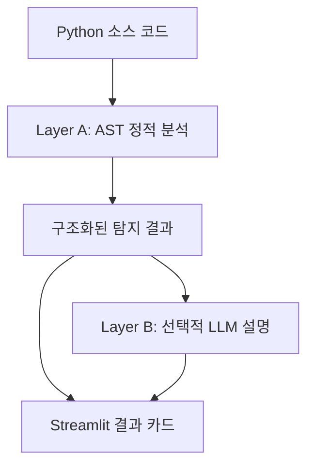

# PromptGuard Lite
### Static Security Analyzer for Python LLM & Agent Applications

LLM·AI 에이전트를 사용하는 Python 코드에서 **보안 검토가 필요한 코드 구조와 데이터 흐름**을 찾는 정적 분석 도구입니다. 분석 대상 코드를 실행하지 않고, OWASP LLM Top 10:2025의 **6개 범주에 매핑한 10개 규칙**으로 위험 패턴을 탐지합니다.

2026 숭실대학교 AI 소프트웨어 공모전 팀 프로젝트 · **은상 수상**

## Overview

LLM의 출력이 그대로 명령 실행에 사용되거나, 비밀정보가 프롬프트에 포함되거나, 에이전트에 연결된 도구가 잘못된 행동으로 이어질 수 있는 상황을 코드 수준에서 검토하기 위해 개발했습니다.

- **Layer A — 정적 탐지:** Python AST를 이용한 위험 API 검색, 제한적인 taint analysis, 에이전트 도구 capability 분석.
- **Layer B — 선택적 AI 설명:** Layer A의 결과를 받아 사용자 수준에 맞는 위험 설명과 수정 방향 생성.
- **Streamlit UI:** 코드 붙여넣기, 단일 `.py` 업로드, 내장 샘플 선택 및 탐지 결과 카드 제공.
- **구조화된 분석 결과:** 규칙, 코드 위치, source–sink 흐름, 근거, 심각도 및 confidence를 Python API에서 조회·JSON 직렬화.

> Finding은 실제 공격 성공을 입증한 결과가 아니며, 이 도구는 우선 검토할 구조적 위험을 표시합니다.

## Architecture



Layer A는 변수 할당, 문자열 조합, 일부 컨테이너·반복문 등을 통한 값의 전파를 추적합니다. 직접 import alias와 제한적인 객체 역할 추론을 활용하고, 알려진 LLM 호출과 위험 sink를 연결합니다. 에이전트 규칙은 도구 내부의 위험 기능과 에이전트에 대한 연결 여부를 함께 확인합니다.

Layer B는 **탐지 규칙이나 severity를 다시 결정하는 분석 엔진이 아니라**, 기존 finding에 `reason`과 `fix`를 덧붙이는 설명 계층입니다. 입문자·개발자·전문가 수준을 선택할 수 있으며, AI 설명을 끄면 정적 탐지만 수행합니다.

## Detection Scope

OWASP LLM Top 10:2025에 근거하여 10가지 중 **정적 분석으로 탐지 가능한 위험**을 분석합니다. 탐지에는 위험 API 검색, source–sink 데이터 흐름 추적, 에이전트 도구의 capability 및 연결 구조 분석을 사용합니다.

| OWASP 2025 범주 | 탐지하는 구조 | 대표 지원 패턴 |
| --- | --- | --- |
| **LLM01 · Prompt Injection** | 외부 콘텐츠가 LLM 입력으로 전달되는 흐름 | 웹 요청 결과, 파일 읽기, 문서 loader, retriever·vector search 결과 → 인식 가능한 모델·chain·agent 호출 |
| **LLM02 · Sensitive Information Disclosure** | 비밀정보 후보가 LLM 입력에 포함되는 흐름 | 환경변수 조회, 변수명·문자열 패턴으로 식별한 API 키·토큰·비밀번호 등 → prompt·messages·input |
| **LLM03 · Supply Chain** | 위험 역직렬화 API 또는 외부 코드 신뢰 설정 사용 | `pickle.load/loads`, `joblib.load`, `torch.load`, `from_pretrained`·`pipeline`의 `trust_remote_code=True` |
| **LLM05 · Improper Output Handling** | LLM 출력이 코드·명령·SQL 실행 지점으로 전달되는 흐름 | 모델·chain·agent 출력 → `eval/exec`, `os.system/popen`, subprocess·asyncio 프로세스 호출, 인식 가능한 SQL 실행 호출 |
| **LLM06 · Excessive Agency** | 고위험 기능을 가진 도구가 에이전트에 연결된 구조 | 코드·명령 실행, 파일 삭제, HTTP 변경 요청, 이메일 전송, 식별 가능한 SQL 쓰기 작업을 포함한 도구의 에이전트 연결 |
| **LLM07 · System Prompt Leakage** | 비밀정보 후보가 특권 프롬프트에 포함되는 구조 | system/developer 메시지, `SystemMessage`, `ChatPromptTemplate`, Responses API의 `instructions`, 알려진 agent factory의 `system_prompt` 및 관련 프롬프트 변수 |

### 지원하는 코드 형태

- **LLM 호출 인식:** OpenAI SDK의 `client.responses.create`·`client.chat.completions.create`와, 알려진 생성자·factory·객체 역할 또는 제한적인 이름 패턴으로 식별한 모델·chain·agent 호출을 지원합니다.
- **값의 전달 추적:** 변수 할당, f-string·문자열 조합, 리스트·딕셔너리, 속성·상수 키 접근, 일부 컨테이너 변경·반복문·comprehension을 통한 전파를 추적합니다.
- **도구 연결 분석:** `@tool`, `Tool`·`StructuredTool`·`FunctionTool`의 일부 생성 패턴과 알려진 agent 생성·연결 패턴을 분석합니다.
- **보조 식별:** 현재 파일의 직접 import alias, 제한적인 객체 역할 추론, 변수명·문자열 기반 휴리스틱을 사용합니다.

이 범위에는 **일부 LangChain·LlamaIndex 스타일의 코드 구조**가 포함되며, 프레임워크 전체나 모든 API·버전을 지원하지 않습니다. 분석은 **Python 단일 파일의 제한적인 정적 추적**을 기준으로 하며, 완전한 파일 간·함수 간 분석이나 실행 경로별 정밀 분석을 수행하지 않습니다.

내부적으로는 위 범주를 **10개의 규칙 ID**로 분류합니다. 규칙 하나가 여러 API와 코드 형태를 다룰 수 있으므로, 규칙 수는 지원 패턴 수나 실제 탐지 건수를 의미하지 않습니다. 상세 정의는 [scanner/rules.py](scanner/rules.py), 판정·추적 로직은 [scanner/analyzer.py](scanner/analyzer.py)를 참고하세요.

### 결과 해석

- **Status:** 프로젝트가 규칙별로 지정한 구조적 위험 상태입니다. 현재 외부 콘텐츠 유입·위험 로딩·고위험 도구 연결은 `risky`, 비밀정보의 LLM 입력 전달·LLM 출력의 실행 지점 전달·특권 프롬프트 내 비밀정보는 `vulnerable`로 분류합니다. 실제 공격 성공이나 악용 가능성이 검증됐다는 뜻은 아닙니다.
- **Severity:** 해당 위험이 악용됐을 때의 예상 영향에 따라 프로젝트가 규칙별로 지정한 등급입니다. 현재 규칙은 `medium`, `high`, `critical`을 사용하며, 실행 환경·권한을 분석해 동적으로 재산정하지 않습니다.
- **Confidence:** 탐지 근거의 명확성을 나타내는 휴리스틱 값(`0.9`, `0.75`, `0.6`)입니다. 규칙 기본값과 source·호출 식별 근거에 따라 결정됩니다. 

Status와 Severity는 **프로젝트 자체의 분류 정책**이며, OWASP가 각 탐지 결과에 부여한 공식 등급이 아닙니다.

> 탐지 결과는 사람이 검토해야 할 구조적 위험을 표시합니다. 정적 분석만으로 입력 콘텐츠의 악성 여부나 실제 정보 유출·도구 실행 여부를 확인하지는 않습니다. 다만 외부 콘텐츠가 LLM 입력으로 전달되고, LLM 출력이 명령 실행이나 외부 시스템에 영향을 줄 수 있는 도구로 이어진다면 악성 입력의 영향이 확산될 가능성이 있습니다. 본 도구는 이러한 경로를 사전에 식별해, 입력 검증·출력 처리·도구 권한 등을 검토할 근거를 제공합니다.

## Quick Start

현재 검토 환경은 Python 3.12입니다. 아래 명령은 저장소 루트에서 실행합니다.

```bash
git clone https://github.com/SSU-PromptGuard/ai-app-security-scanner.git
cd ai-app-security-scanner
python -m venv .venv
```

가상환경을 활성화합니다.

```bash
# macOS / Linux
source .venv/bin/activate
```

```powershell
# Windows PowerShell
.venv\Scripts\Activate.ps1
```

의존성을 설치하고 UI를 시작합니다.

```bash
python -m pip install -r requirements.txt
python -m streamlit run app.py
```

**정적 탐지만 사용할 때는 API 키가 필요하지 않습니다.** UI에서 "AI로 이유와 해결 방법까지 보기"를 끈 상태로 검사합니다.

### Optional: Layer B 설정

`.env.example`을 복사해 저장소 루트에 `.env`를 만듭니다.

```bash
# macOS / Linux
cp .env.example .env
```

```powershell
# Windows PowerShell
Copy-Item .env.example .env
```

현재 구현의 기본 연결 대상은 숭실대학교 MindLogic API Gateway입니다. 이용 가능한 Gateway 자격 증명과 모델 접근 권한이 필요합니다.

| 환경변수 | 용도 |
| --- | --- |
| `OPENAI_API_KEY` | Layer B의 키 유무 확인 및 GPT/Gemini 호출 |
| `OPENAI_BASE_URL` | GPT/Gemini용 OpenAI 호환 Gateway 주소 |
| `ANTHROPIC_AUTH_TOKEN` | Claude 호출용 토큰. 생략 시 `OPENAI_API_KEY` 사용 |
| `CLAUDE_BASE_URL` | Claude용 Gateway 주소 |

현재 `judge()`는 Claude 선택 시에도 `OPENAI_API_KEY`가 설정되어 있는지 먼저 확인합니다. Claude만 사용할 때도 이 변수의 설정이 필요합니다.

선택 가능한 모델 ID와 기본값은 [engine/layer_b.py](engine/layer_b.py)의 `MODELS`, `DEFAULT_MODEL`에 정의되어 있습니다. 현재 기본값은 `gpt-5.4`입니다. 다른 제공사 endpoint로 변경할 경우 모델 ID와 인증 방식의 호환성을 별도로 확인해야 합니다.

**AI 설명을 켜면 finding의 코드 근거·흐름·파일명 등이 설정된 외부 API로 전송됩니다.** 민감한 코드를 다룰 때는 전송 범위를 확인하고, API 키가 담긴 `.env`는 commit하지 마세요.

## Usage

### UI

1. 내장 샘플을 선택하거나 코드를 붙여넣고, 또는 단일 `.py` 파일을 업로드합니다.
2. 필요하면 AI 설명과 사용자 수준·모델을 선택합니다.
3. **검사하기**를 누릅니다.
4. 탐지 카드에서 source, sink, 코드 근거와 위험 수준을 확인합니다.

### Python API — API 키 없이 분석

```python
import json
from scanner import scan_code

source = """
command = agent.run("build a shell command")
subprocess.run(command, shell=True)
"""

result = scan_code(source, filename="example.py")
print(json.dumps(result.to_dict(), indent=2, ensure_ascii=False))
```

이 문자열은 실행되지 않고 AST로 분석됩니다. 위 예시는 `LLM05_LLM_OUTPUT_TO_SHELL` 규칙으로 탐지되며 `vulnerable / critical`로 분류됩니다.

- `scan_code(source, filename)`: 파싱 상태·findings·요약을 포함한 `ScanResult` 반환.
- `scan_file(path)`: 파일을 읽어 `ScanResult` 반환.
- `analyze_code(source, filename)`: finding 목록만 반환하는 호환 API.

출력 모델은 [scanner/models.py](scanner/models.py), JSON Schema는 [schemas/result_schema.json](schemas/result_schema.json)에 정의되어 있습니다. 파싱 오류를 구분해야 할 때는 `scan_code` 또는 `scan_file`의 `ok`와 `parse_error`를 확인하세요.

## Validation

### 포함된 개발 샘플 평가

[data/labels.csv](data/labels.csv)의 **13개 개발 샘플**을 현재 코드로 평가한 결과입니다(2026-10-29). 파일별로 finding이 하나 이상 있으면 positive로 판정하고, 정답의 `risky`·`vulnerable`을 positive, `safe`를 negative로 처리합니다.

| 항목 | 결과 |
| --- | ---: |
| Positive / Negative 샘플 | 10 / 3 |
| TP / FP / FN / TN | 10 / 0 / 0 / 3 |
| Precision / Recall / Accuracy | 1.00 / 1.00 / 1.00 |

**규칙 개발에 사용한 소규모 샘플에서의 동작 확인이며, 독립 테스트셋이나 실제 저장소 전반에 대한 일반화 성능을 나타내지 않습니다.** 이 평가는 파일 단위 이진 탐지 기준이므로, 범주·위치·설명 정확도와도 구분해야 합니다.

재현하려면 전체 의존성 설치 후 다음을 실행합니다.

```bash
python -c "from scanner import evaluate; metrics, table = evaluate('.'); print(metrics); print(table.to_string(index=False))"
```

### 회귀·계약 테스트

```bash
python verify_scanner.py
python -m pip install jsonschema
python -m unittest discover -s tests -p "test_layer_a_*.py" -v
```

2026-10-29 Python 3.12.14 환경에서 smoke 검증과 **47개 테스트가 모두 통과**했습니다. 테스트는 규칙 계약, 샘플 탐지, 결과 구조, 중복 처리, sanitizer 처리 및 실제 코드 형태를 모사한 패턴 등을 검증합니다.

`jsonschema`는 선택적 테스트 의존성입니다. 설치하지 않으면 스키마 관련 테스트 2개가 건너뛰어집니다. 외부 LLM 호출과 UI 화면 동작은 이 테스트 범위에 포함되지 않습니다.

현재 저장소에는 Layer B 설명 품질의 정량 평가나 대규모 실제 저장소 대상 성능을 확정할 자료가 포함되어 있지 않아, 해당 수치는 제시하지 않습니다.

## Repository Guide

| 경로 | 내용 |
| --- | --- |
| `app.py` | Streamlit 입력·탐지 결과 UI |
| `scanner/` | AST 분석기, 규칙, 결과 모델, 개발 샘플 평가 |
| `engine/layer_b.py` | 선택적 LLM 설명 생성 |
| `samples/dev/` | 10개 위험 패턴 샘플과 3개 safe 샘플 |
| `tests/` · `verify_scanner.py` | 회귀·계약 테스트 및 smoke 검증 |
| `schemas/result_schema.json` | 분석 결과 JSON Schema |
| `docs/decisions/` | 설계·규칙·출력 계약 문서 |
| `docs/layer_a_real_world_*.md` | Layer A 개선 및 검증 기록 |
| `reports/final_report.md` | 공모전 보고서 |

상세 설계 배경은 [범위·기획 문서](docs/decisions/01_scope_background.md), 구현 보강 사항은 [Layer A hardening 보고서](docs/layer_a_real_world_hardening_report.md)를 참고하세요. 기존 설계·공모전 보고서에는 계획 단계 표현과 미완성 항목이 일부 남아 있으며, 현재 동작은 코드와 이 README를 기준으로 확인할 수 있습니다.

## Limitations

- **Python 단일 파일 분석**입니다. 저장소 전체의 파일 간 흐름이나 완전한 함수 간 호출 그래프를 분석하지 않습니다.
- 제한적인 taint·역할 추론을 사용하며, 실행 경로별 정밀 분석, 동적 key, 일반 객체 alias 및 모든 프레임워크 타입을 지원하지 않습니다.
- Prompt injection 성공 여부, 실제 secret 유출, 에이전트의 도구 실행 여부를 실험하지 않습니다.
- 비밀정보·호출 이름에 대한 휴리스틱과 제한적인 sanitizer 처리로 오탐·미탐이 발생할 수 있습니다. finding이 없다고 안전을 보증하지 않습니다.
- Dependency CVE 감사, 모델 파일 무결성 검증 및 runtime 권한 분석은 지원하지 않습니다.
- Layer B는 외부 API·모델 접근 권한이 필요하며, 생성된 설명과 수정안은 사람이 검토해야 합니다.
- 의존성 버전이 고정되어 있지 않아 설치 시점에 따라 환경 호환성 확인이 필요할 수 있습니다.

## Team & Contributions

3인 팀 프로젝트입니다. 역할 분담은 다음과 같습니다.

| 팀원 | 주요 역할 |
| --- | --- |
| 동균 | 팀장, Layer A 엔진·정적 분석 |
| 진아 | 샘플셋·라벨링·평가 |
| 지현 | UI·통합·보고서 |
